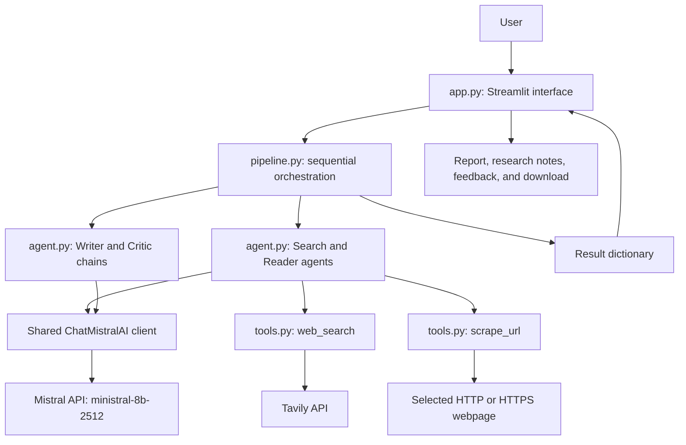
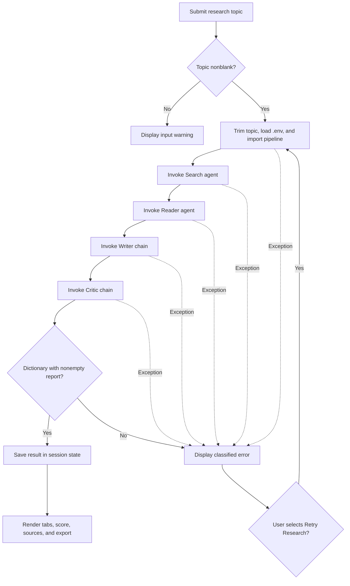
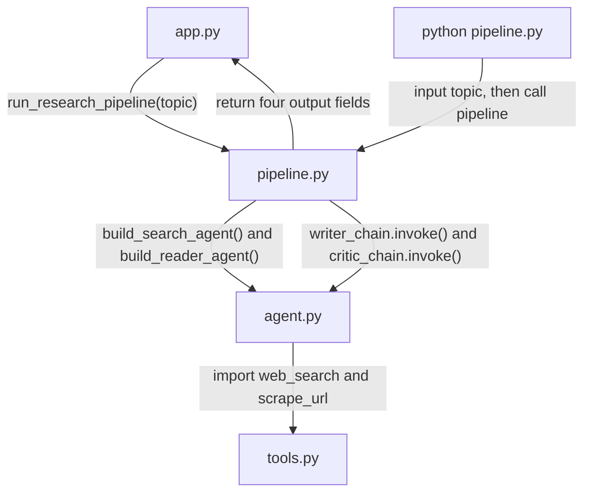
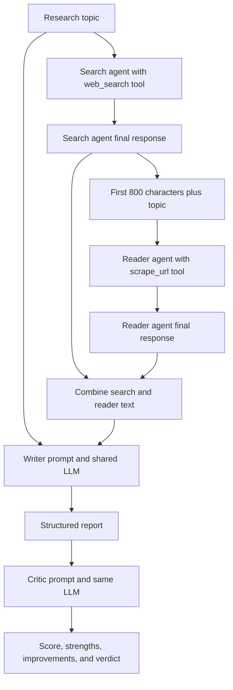

# ResearchMind AI

**A Streamlit research assistant that connects web discovery, webpage reading, report writing, and AI review in one sequential workflow.**

ResearchMind AI turns a research topic into a structured report and a separate critic review using LangChain, Mistral AI, and Tavily. Explore the search summary, reader output, report, and feedback in a native Streamlit dashboard, then download the report as Markdown.

> **Implementation scope:** Two tool-using agents (Search and Reader) followed by two prompt-based chains (Writer and Critic). All four stages use the same configured Mistral model. The interface currently displays **AI Research Assistant** and **Research Studio**; ResearchMind AI is the project name used in this documentation.

## Contents

- [Overview](#overview)
- [Key features](#key-features)
- [Technology stack](#technology-stack)
- [System architecture](#system-architecture)
- [End-to-end workflow](#end-to-end-workflow)
- [Module interactions](#module-interactions)
- [AI research process](#ai-research-process)
- [Project structure](#project-structure)
- [Installation and configuration](#installation-and-configuration)
- [Running the project](#running-the-project)
- [Using the application](#using-the-application)
- [Example topics](#example-topics)
- [Troubleshooting](#troubleshooting)
- [Security and data handling](#security-and-data-handling)
- [Current limitations](#current-limitations)
- [Customization](#customization)
- [Future improvements](#future-improvements)
- [Contributing](#contributing)

## Overview

### Problem

Researching a technical topic usually means switching between search results, reading pages, organizing notes, drafting a report, and reviewing its quality. ResearchMind AI brings these steps into a single interface while keeping intermediate outputs visible for inspection.

### Solution

A Python pipeline executes four stages in order:

1. **Search:** A LangChain agent has access to a Tavily search tool.
2. **Reader:** A second agent is asked to select the most relevant URL and extract deeper content using an HTTP scraper.
3. **Writer:** A prompt chain combines the search and reader outputs into a report.
4. **Critic:** A separate prompt chain reviews the report and requests a score out of 10, strengths, improvement areas, and a verdict.

This project demonstrates tool integration, sequential orchestration, prompt composition, and a usable GenAI interface. Its intermediate outputs help developers inspect the information supplied to the writing stage.

**Evidence boundary:** Reports and scores are model-generated. Source URLs are extracted from returned text and are not independently verified; the critic receives the report alone, rather than original pages or separate ground-truth evidence.

## Key features

| Capability | Implemented behavior |
| --- | --- |
| Topic input | Multiline Streamlit form with rejection of blank or whitespace-only submissions. |
| Web discovery | Tavily search tool requests up to 5 results and formats titles, URLs, and snippets of up to 300 characters each. |
| Page reading | Requests and BeautifulSoup extract a title, up to 10 `h1`/`h2` headings, and up to 3,000 characters of paragraph text. |
| Structured report | Writer prompt requests Introduction, Key Findings with at least 3 points, Conclusion, and Sources. These are prompt instructions rather than schema-enforced guarantees. |
| AI review | Critic prompt requests a score, strengths, improvement areas, and a one-line verdict; raw feedback remains available. |
| Research workspace | Four tabs: Final report, Search results, Scraped content, and Critic feedback. |
| Export and copying | Download `research_report.md` or open a code block with Streamlit's copy control. |
| Source navigation | Deduplicated HTTP(S) links extracted from pipeline outputs, displayed as link buttons. |
| Session results | Retains the last completed result during normal session interactions and shows elapsed time and completion timestamp. |
| Failure recovery | Friendly UI error classification and a manual **Retry Research** button that starts the full pipeline again. |
| Execution modes | Streamlit dashboard or interactive terminal pipeline. |

The UI contains a four-stage status display. **With the supplied pipeline, individual stages are not tracked live:** `run_research_pipeline(topic)` has no progress callback. All stages are marked complete after a successful return. Callback-based partial results are also unavailable with this pipeline.

## Technology stack

| Technology / package | Role in the source |
| --- | --- |
| Python | Application, tools, and orchestration. No supported version is declared in the supplied files. |
| `streamlit` | Native dashboard, forms, status indicators, tabs, session state, and downloads. |
| `langchain` | `create_agent` and `@tool` integration. |
| `langchain-core` | `ChatPromptTemplate` and `StrOutputParser`. |
| `langchain-mistralai` | `ChatMistralAI`, configured as `ministral-8b-2512` in `agent.py`. |
| `tavily-python` | `TavilyClient` for web search. |
| `requests` | HTTP page retrieval with a 15-second request timeout. |
| `beautifulsoup4` | HTML parsing and text extraction. |
| `python-dotenv` | Loading environment configuration. |
| `rich` | Imported in `tools.py`; the supplied pipeline uses standard `print` for terminal output. |

No package versions, dependency manifest, lockfile, theme configuration, or deployment configuration were included in the reviewed upload.

## System architecture

The Streamlit application calls the pipeline, which coordinates the objects defined in `agent.py`. Search and Reader can invoke their respective tools; Writer and Critic call the shared Mistral client without tools.



The tools are available to the agents through LangChain. Actual tool calls depend on model behavior; the pipeline does not directly invoke Tavily or the scraper.

## End-to-end workflow

The dashboard validates input, lazily imports the pipeline, and displays its returned result. An uncaught pipeline exception reaches the UI's error handler; manual retry repeats the entire attempt.



`scrape_url` returns invalid-URL and HTTP-request failures as **text**, so those failures do not necessarily interrupt the pipeline. The returned text may instead flow into the reader response and report.

## Module interactions

Imports and calls follow a one-way dependency structure. `app.py` imports the pipeline inside `run_research`; `pipeline.py` imports the two agent builders and two chain objects; `agent.py` imports the tools.



The application does not import the tools directly. `tools.py` does not call back into the pipeline or UI.

### Pipeline output contract

`run_research_pipeline(topic: str) -> dict` returns the following fields only after all four stages finish:

| Field | Value |
| --- | --- |
| `search_result` | Content of the Search agent's final message, rather than the raw Tavily response. |
| `scraped_content` | Content of the Reader agent's final message, rather than a guaranteed raw scraper payload. |
| `report` | Writer-chain string output. |
| `feedback` | Critic-chain string output. |

The pipeline holds intermediate values in a local dictionary. It does not return that dictionary early when a stage raises an exception.

## AI research process

This view shows how evidence is reduced and passed between stages. The Reader receives only the first 800 characters of the Search agent's final response; the Writer receives the complete stored search and reader outputs.



The Reader is prompted to pick one relevant URL. The scraper removes `script`, `style`, `nav`, and `footer` elements before extracting text. The critic produces feedback only: **there is no automatic rewrite or critic-to-writer revision loop**.

## Project structure

The logical module names below are required by the Python imports and original run instructions:

```text
<repository-root>/
├── app.py          # Streamlit entry point and presentation helpers
├── pipeline.py     # Sequential research execution and terminal entry point
├── agent.py        # Shared model, two agent builders, two prompt chains
├── tools.py        # Tavily search and HTTP webpage extraction tools
└── README.md       # Project documentation
```

Create `.env` locally for credentials; it is configuration, not a supplied file. No `requirements.txt`, `pyproject.toml`, `.gitignore`, or `LICENSE` was supplied for inspection.

**Upload naming note:** The reviewed attachments were named `app(1).py`, `pipeline(1).py`, and `README(1).md`, alongside `agent.py` and `tools.py`. The structure above describes the intended repository module names; it does not assert that the uploaded copies already have those names. In particular, `from pipeline import run_research_pipeline` requires an importable `pipeline.py`. The Python files have not been renamed or modified as part of this documentation update.

| File | Important responsibilities |
| --- | --- |
| `app.py` | `main()` builds the dashboard; `run_research()` invokes the pipeline; helpers normalize output, parse feedback, extract links, classify errors, and render results. |
| `pipeline.py` | `run_research_pipeline()` invokes Search → Reader → Writer → Critic and returns the result dictionary. Its main guard prompts for a topic in the terminal. |
| `agent.py` | Creates a shared `ChatMistralAI` instance, exposes `build_search_agent()` and `build_reader_agent()`, and composes the Writer and Critic chains with string parsers. |
| `tools.py` | Defines `web_search(query)` and `scrape_url(url)` as LangChain tools; initializes Tavily from environment configuration. |

## Installation and configuration

### 1. Obtain the repository

The supplied files do not identify a repository URL or owner. Copy the actual clone URL from your repository's **Code** menu and substitute the placeholders below:

```powershell
git clone <ACTUAL_REPOSITORY_URL>
cd <ACTUAL_CLONED_DIRECTORY>
```

These placeholders are not executable values. Confirm that `app.py`, `pipeline.py`, `agent.py`, and `tools.py` are together in the repository root before proceeding. If you are using only the attachment copies with `(1)` suffixes, resolve their module names in your local checkout first.

### 2. Create and activate a virtual environment

From the repository root in Windows PowerShell:

```powershell
python -m venv .venv
.\.venv\Scripts\Activate.ps1
```

If PowerShell blocks activation, use the environment's interpreter directly in the remaining commands, replacing `python` with `.\.venv\Scripts\python.exe`. No execution-policy change is required for that approach.

### 3. Install dependencies

**No dependency file was supplied**, so a `pip install -r requirements.txt` instruction cannot be verified. The following command combines the original README's package list with the imports present in the code:

```powershell
python -m pip install streamlit langchain langchain-mistralai langchain-core tavily-python beautifulsoup4 requests python-dotenv rich
```

This is an **unpinned installation baseline**, not a tested reproducible environment. Confirm package compatibility locally, especially support for `langchain.agents.create_agent` and Streamlit APIs such as `st.container(horizontal=True)`, button `width`, and download `on_click="ignore"`. A tested Python version and package pins remain to be documented.

If the full repository already contains a dependency manifest, use that verified manifest instead.

### 4. Configure credentials

Create a local `.env` beside the application modules:

```dotenv
MISTRAL_API_KEY=replace_with_your_mistral_api_key
TAVILY_API_KEY=replace_with_your_tavily_api_key
```

| Variable | Usage |
| --- | --- |
| `MISTRAL_API_KEY` | Mistral integration credential documented by the original README. `ChatMistralAI` is initialized without an explicit key argument and relies on provider environment configuration. |
| `TAVILY_API_KEY` | Explicitly read with `os.getenv("TAVILY_API_KEY")` in `tools.py` and passed to `TavilyClient`. |

The original README links to the [Mistral console](https://console.mistral.ai) and [Tavily dashboard](https://app.tavily.com) for credentials. Confirm account access, API quotas, and access to the configured model before running research.

The UI loads `.env` relative to `app.py` with `override=False` before importing the pipeline. `agent.py` and `tools.py` also call `load_dotenv()`. Existing environment variables take precedence over `.env` values.

## Running the project

### Streamlit dashboard

Run from the repository root with the virtual environment active:

```powershell
python -m streamlit run app.py
```

Open the local URL printed by Streamlit; the original README uses `http://localhost:8501` as the default address.

### Terminal pipeline

```powershell
python pipeline.py
```

Enter a topic when prompted. The script prints each stage's output in the terminal. This mode does not use the dashboard's input validation, session state, friendly error classification, or retry button.

These commands match the intended module layout. They have not been exercised against live Mistral or Tavily services during this documentation review.

## Using the application

1. Enter a focused topic in **What would you like to research?** Include the scope or questions you want explored.
2. Select **Start Research**. The app trims whitespace, loads configuration, and runs the pipeline under a status indicator and spinner.
3. Wait for completion. The supplied pipeline does not emit stage-level progress events.
4. Open the **Final report**, **Search results**, **Scraped content**, and **Critic feedback** tabs to inspect outputs.
5. Review the critic score and full feedback. Follow source links and check important claims against the original pages.
6. Select **Download Report** for a Markdown file or **Copy Report** to expose Streamlit's copyable code block.
7. If the attempt fails, review the friendly error and select **Retry Research** after addressing its cause. A previous completed result remains visible when available.

Session state is temporary: a browser refresh or session reset may clear results. No database, persistent report history, or account system is implemented.

## Example topics

| Research topic | Expected path |
| --- | --- |
| `Compare vector databases for a production RAG application.` | Search relevant material, read a selected page, draft a comparison, and critique the report. This researches RAG; the app itself does not implement RAG. |
| `Explain how tool calling works in LangChain agents, including common failure cases.` | Discover references, extract page content, write findings, and request a quality review. |
| `Compare dense and sparse retrieval for technical documentation search.` | Use the same four-stage workflow to produce a report with source links and feedback. |

The writer is instructed to produce Introduction, Key Findings, Conclusion, and Sources. Exact findings, formatting, citations, and scores depend on provider responses and retrieved material; these examples are prompts, not recorded test results.

## Troubleshooting

| Symptom | Explanation and next step |
| --- | --- |
| Missing `pipeline`, `agent`, or `tools` module | Confirm module filenames and that all files are together. An attachment called `pipeline(1).py` does not satisfy `import pipeline`. |
| Missing Python package | Install dependencies into the interpreter that launches Streamlit; check with `python -m pip --version`. |
| Cannot import `create_agent`, or Streamlit rejects a keyword | Installed package APIs may differ. Verify versions that support the APIs used by the source; no compatible version set has been supplied. |
| Authentication error / HTTP 401 | Check both credentials, existing environment-variable overrides, and provider access to the configured model. Do not paste keys into screenshots or issues. |
| Rate limit / HTTP 429 | Wait for the provider's retry window and check account quotas, then manually retry. The project has no application-level backoff policy. |
| Timeout or connection error | Check network access to the providers and selected webpage. Scraper requests use `timeout=15`; this is not a total pipeline deadline. |
| `Website request failed` appears as research text | The scraper converts Requests exceptions into text. Check the source URL or try another topic; the pipeline may continue with that failure text. |
| Progress stays at 0 of 4 until completion | Expected with the supplied pipeline: it has no `on_progress` parameter. |
| No partial outputs after a failed attempt | Expected with the supplied pipeline: the UI receives no intermediate snapshots. |
| Improvement summary is missing | The critic prompt says `Areas to Improve`, while the UI parser recognizes other headings such as `Areas for improvement`. Read **Complete critic feedback** for the original text. |
| Strengths summary includes later sections | The heading-based parser may not stop at the prompt's `Areas to Improve` heading. Use the full feedback as the authoritative review. |
| No score or source links | Output formatting may vary; score and URL extraction are best-effort. Inspect raw feedback and search text. |
| Scraped content is sparse | The scraper reads returned HTML paragraphs; it does not render JavaScript, bypass access controls, or parse PDFs. |
| Writer returned an empty report | The UI rejects a missing or whitespace-only report; retry after checking provider availability and source quality. |

## Security and data handling

- Keep credentials in local environment configuration. No hard-coded API credentials were found in the supplied Python files.
- Add `.env` and `.venv/` to your repository's ignore rules before committing; no `.gitignore` was supplied to confirm protection. Review staged changes for secrets, and rotate a key if exposed.
- The UI classifies common errors rather than displaying raw provider exception payloads. This does not replace secret scanning or log review, especially in terminal mode and scraper-returned error text.
- Topics are sent to the research providers. Retrieved content and generated outputs are supplied to Mistral during the workflow. Avoid submitting confidential material without appropriate authorization.
- The scraper validates the HTTP(S) scheme and presence of a hostname. It does **not** block private-network addresses or validate redirect destinations; additional URL restrictions are needed before exposing it as an unrestricted hosted service.
- External webpages are untrusted input. Dedicated prompt-injection defenses and independent citation verification are not implemented.

## Current limitations

- **Sequential execution:** Stages run one after another, with no project-level parallel research or background job queue.
- **Limited evidence depth:** Search requests up to 5 results, snippets are truncated to 300 characters, and the Reader sees only 800 characters of the search response. The Reader is instructed to choose one URL, but tool-call count is not explicitly enforced.
- **Basic extraction:** Up to 10 headings and 3,000 paragraph characters per scrape; no browser rendering, PDF ingestion, or document-upload workflow.
- **Shared model:** Search, Reader, Writer, and Critic use the same model configuration. The critic is a separate prompt invocation, not an independent factual verification service.
- **No revision loop:** Feedback does not trigger another draft or determine a pass/fail threshold.
- **No guaranteed structure:** Reports and reviews are plain strings. Prompt instructions and regex parsing do not enforce output schemas or complete source coverage.
- **Progress integration gap:** Live stage events, accurate failed-stage identification, and partial-result display require a callback the supplied pipeline does not implement.
- **Temporary state:** No persistent memory, vector database, caching layer, saved history, user authentication, or multi-user access controls are implemented.
- **Packaging and validation gaps:** No supplied dependency pins, supported Python declaration, automated tests, deployment configuration, or benchmark evidence. The reviewed files do not establish production readiness.
- **Presentation:** The UI uses native Streamlit components. A fixed dark theme is not configured in the supplied files.

## Customization

These are existing code locations for future adjustments; this README update does not change their behavior.

| Setting | Location |
| --- | --- |
| Model identifier shared by all stages | `agent.py`: `ChatMistralAI(model="ministral-8b-2512")`. |
| Search result count and snippet length | `tools.py`: `max_results=5` and `r['content'][:300]`. |
| Scraping timeout and extraction limits | `tools.py`: `timeout=15`, `headings[:10]`, and `text[:3000]`. |
| Search context available to Reader | `pipeline.py`: `state['search_result'][:800]`. |
| Report structure | `agent.py`: `writer_prompt`. |
| Review criteria and requested format | `agent.py`: `critic_prompt`. |
| Feedback parsing and result presentation | `app.py`: `feedback_parts()` and `render_result()`. |

## Future improvements

The following are proposals, **not implemented features**:

- Publish a tested dependency manifest, supported Python version, and repeatable setup checks.
- Add pipeline progress callbacks and intermediate-state snapshots for accurate dashboard status and partial recovery.
- Align critic headings with the UI parser or use validated structured feedback.
- Improve evidence coverage through multiple-page retrieval, preserved source metadata, and citation checks.
- Add explicit application-level retry/backoff policies and clearer handling of tool failures.
- Introduce URL restrictions and prompt-injection safeguards before wider hosting.
- Add focused tests for orchestration, failure paths, output parsing, and URL handling.
- Explore optional report history, caching, PDF support, or a bounded revision loop after validating the core workflow.

## Contributing

1. Open an issue describing the problem or proposed improvement, with reproducible steps where relevant.
2. Create a focused branch and keep changes scoped to one concern.
3. Validate the dashboard and terminal workflow with your configured environment; include package versions and describe what you actually tested.
4. Submit a pull request with the behavior change and any known limitations. Never include `.env`, API keys, or private research data.

Repository ownership, author links, and a confirmed license were not present in the supplied files. Add verified project metadata and a license decision before publishing reuse terms.
